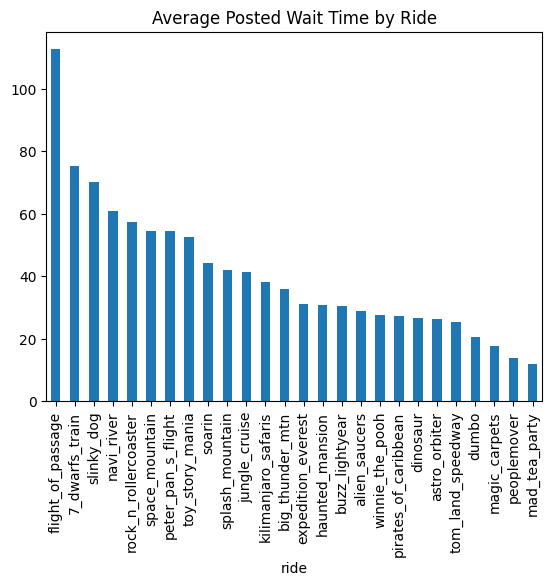
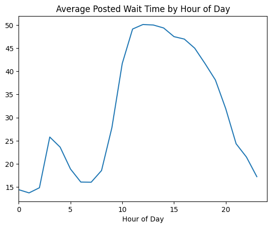
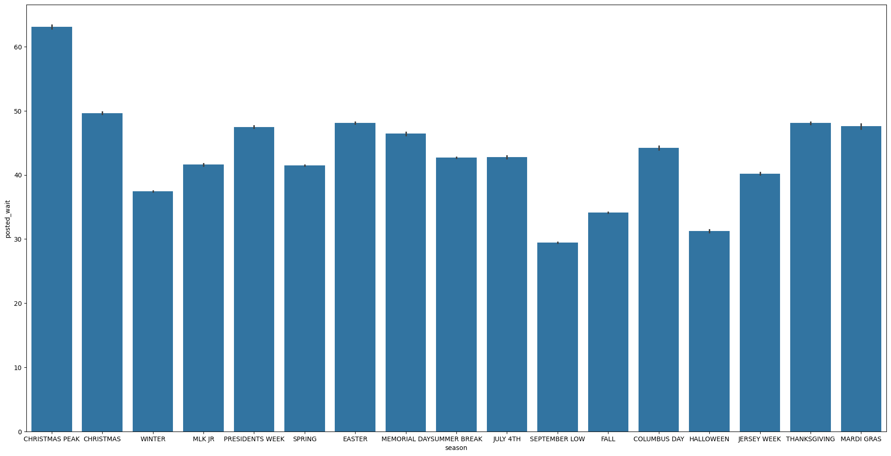
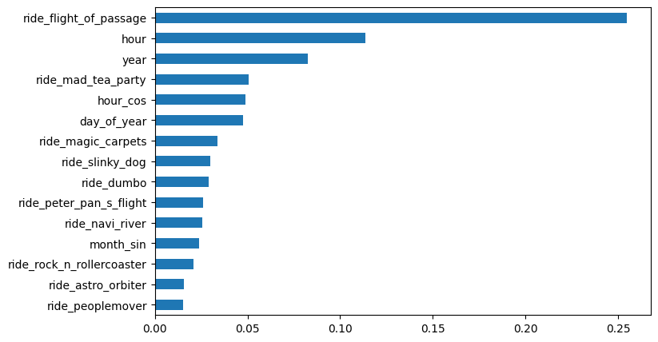
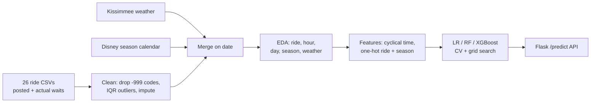

# When Are Disney World Lines Longest? Predicting Ride Wait Times with Machine Learning

   

**TL;DR**
- Combined **~7M wait time readings across 26 Walt Disney World rides (2015–2021)** with daily Kissimmee weather and Disney's season and holiday calendar.
- **The calendar matters more than the weather.** Christmas Peak averages **63 min** vs **29 min** in September Low, while temperature (r = −0.08) and rain (r = −0.01) barely move wait times.
- Lines peak **11am–2pm (~50 min)** and are shortest at **opening, 6–8am (~16 min)**, about a 3x difference.
- **Random Forest** is the best model: **MAE 22.6 min**, nearly halving the error of Linear Regression (40.5 min). Predictions are served through a small **Flask API**.

## Question
- How long will I wait for a given ride, on a given day, at a given time? And which factors (time of day, season, weather, the ride itself) drive wait times the most?

## Key Findings

### 1. The ride you pick matters most, and Flight of Passage is in a league of its own.
Flight of Passage averages about **113 min**, roughly 1.5x the next longest line (7 Dwarfs Mine Train, ~75 min; Slinky Dog Dash, ~70 min). It's also the least predictable ride (std 53.6 min). At the other end, Mad Tea Party, PeopleMover and Magic Carpets average under 20 min. Ride identity is also the top feature in both tree models.



### 2. Go early: midday waits are about 3x opening waits.
Average waits climb from ~16 min at 6–8am to a plateau of **~50 min from 11am to 2pm**, then taper through the evening to ~17 min by 11pm.



### 3. Season sets the baseline. Christmas Peak is twice as busy as September.
| Busiest seasons | Avg wait | Quietest seasons | Avg wait |
|---|---|---|---|
| Christmas Peak | 63.1 min | September Low | 29.5 min |
| Christmas | 49.7 min | Halloween | 31.3 min |
| Easter | 48.1 min | Fall | 34.1 min |
| Thanksgiving | 48.1 min | Winter | 37.5 min |



### 4. Weather barely matters, and day of week matters less than expected.
Temperature (r = −0.08) and precipitation (r = −0.01) are only weakly correlated with wait times, so rainy days don't clear out the lines much. Saturday is the busiest day (~42.7 min), but **Monday is almost as busy (~42.4 min)** and Sunday is one of the quietest (~38.2 min). The spread from busiest to quietest day is under 5 min.

## Model Results
| Model | MAE (min) | RMSE (min) | 5-fold CV MAE (min) |
|---|---|---|---|
| Linear Regression | 40.53 | 44.50 | n/a |
| **Random Forest** | **22.60** | **27.69** | 29.19 ± 4.27 |
| XGBoost | 24.19 | 28.08 | 26.15 ± 3.69 |

- Tree models beat the linear baseline by ~45%, since wait times depend on interactions (e.g. ride × hour × season) that a linear model can't capture.
- Random Forest wins on the test set, but XGBoost has a lower and more stable CV error, so the API returns the average of both.
- **Most important features:** ride identity (Flight of Passage alone accounts for 25% of RF importance), hour of day, year and day of year.



**Example predictions (RF + XGB average):**
| Ride | Date / time | Conditions | Predicted wait |
|---|---|---|---|
| Flight of Passage | Dec 22, 2pm | Christmas Peak, 88°F, dry | **164 min** |
| Mad Tea Party | Sep 4, 2pm | September Low, 88°F, dry | **6 min** |

## Approach

- **Target:** `posted_wait`, the posted wait time in minutes. Missing values are filled with the actual wait (where available), then with the median for that ride × month × weekday × hour.
- **Cleaning:** removed negative / `-999` sentinel values and capped actual waits at Q3 + 1.5×IQR per ride. Missing temperatures (`-99.9`) were filled with a centered 7-day rolling mean.
- **Features:** year, month, day, hour, day of week, weekend flag, week / day of year, sin/cos encoding of month and hour, mean/max/min temperature, temperature range, precipitation, and one-hot ride and season.
- **Validation:** 80/20 train/test split, 5-fold CV and grid search over RF and XGBoost hyperparameters, scored on MAE.

## Data
- **Wait times:** posted (`SPOSTMIN`) and actual (`SACTMIN`) waits for 26 rides across Magic Kingdom, EPCOT, Hollywood Studios and Animal Kingdom, 2015–2021. After cleaning: **6,969,147 rows**, waits range 0–390 min (mean 39.6, median 30).
- **Weather:** daily precipitation and mean/max/min temperature from Kissimmee, FL.
- **Calendar:** Disney park season and holiday labels per date (`metadata`).
- Raw data isn't included in this repo due to size. [Download it here](https://drive.google.com/drive/folders/10vja2BRC6dOKRijGzBRGuL99LhjXdDsX?usp=share_link) and place the files in `data/raw/`.

## Assumptions and Limitations
- **Train/test split:** the split takes the last 20% of rows, but rows are stacked ride by ride, so the test set is mostly the last few rides in the list (roughly Soarin' through Winnie the Pooh) that the model didn't see during training. A chronological split (e.g. train 2015–2019, test 2020–2021) or a split within each ride would give a fairer error estimate.
- **Posted ≠ actual:** posted waits are Disney's estimates and usually run higher than what guests actually wait. Actual waits are sparse, so they only fill gaps.
- **COVID-19:** 2020–2021 includes the park closure and reduced capacity reopening, which changes crowd behavior.
- **Weather is daily, not hourly,** so an afternoon thunderstorm isn't captured. The API also approximates max/min temp as mean ±5°F.
- **Imputation** uses medians computed over the full dataset, which leaks a small amount of test information into training.

## Repo structure
```text
disneypred/
├── README.md
├── metadata.csv.numbers        # Disney season / holiday calendar
├── notebooks/
│   ├── dataset.ipynb           # cleaning → EDA → features → models
│   └── app.py                  # Flask API serving /predict
├── reports/figures/            # charts used above
└── data/raw/                   # raw CSVs (not tracked, see Data)
```

## How to reproduce
```bash
git clone https://github.com/brittneychan/disneypred.git && cd disneypred
python -m venv .venv && source .venv/bin/activate
pip install pandas numpy scikit-learn xgboost matplotlib seaborn plotly flask flask-cors
# download the raw data into data/raw/ and update the file paths in the first cells
jupyter lab                     # run notebooks/dataset.ipynb top to bottom
```

**Run the prediction API** (after saving the trained models as `rf_model.pkl`, `xgb_model.pkl`, `lr_model.pkl` and `columns.pkl` in `notebooks/`):
```bash
cd notebooks && python app.py
curl -X POST http://127.0.0.1:5000/predict -H "Content-Type: application/json" \
  -d '{"ride": "flight_of_passage", "date": "2024-12-22", "hour": 14,
       "mean_temp": 88, "precipitation": 0.0, "season": "CHRISTMAS PEAK"}'
# → {"rf": ..., "xgb": ..., "lr": ..., "avg": ...}
```
